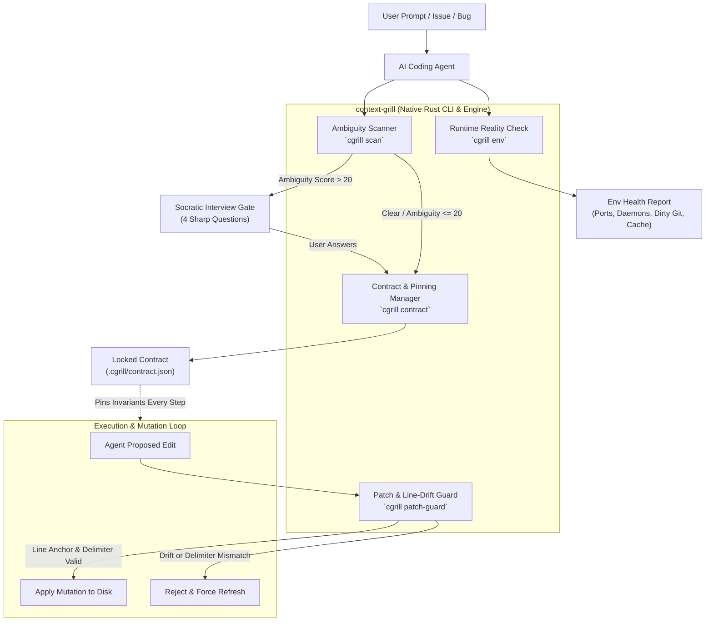

# context-grill: Architecture & Technical Map

An ultra-fast, native Rust engine and agent skill designed to eliminate the five existential failure modes of autonomous coding agents:
1. **Silent Assumptions & Over-Engineering** (guessing vague intent and building unwanted abstractions)
2. **Runtime State Blindness** (debugging ghost code while daemons, stale caches, and zombie ports cause failures)
3. **Line Drift & Bracket Corruption** (sloppy edits on large files that clip braces and break AST syntax)
4. **Blast Radius Violations** (mutating unrelated working files outside declared scope)
5. **Context Amnesia in Long Loops** (losing early constraints and edge cases past step 15)

---

## 1. System Architecture



---

## 2. Core Rust Crates & Project Layout

```
context-grill/
├── Cargo.toml
├── Cargo.lock
├── SKILL.md                          # Universal Agent Skill definition
├── crates/
│   ├── cgrill-core/                  # Core domain logic & data structures
│   │   ├── Cargo.toml
│   │   └── src/
│   │       ├── lib.rs
│   │       ├── ambiguity.rs          # Lexical & fuzzy ambiguity analysis
│   │       ├── interview.rs          # Question generation & heuristic weights
│   │       ├── env_scanner.rs        # Sockets, daemons, git state, build caches
│   │       ├── contract.rs           # Schema, locking, state verification
│   │       └── patch_guard.rs        # Line anchor, bracket/AST balance validator
│   └── cgrill-cli/                   # High-performance native CLI
│       ├── Cargo.toml
│       └── src/
│           ├── main.rs
│           └── commands/
│               ├── scan.rs           # `cgrill scan <prompt>`
│               ├── env.rs            # `cgrill env`
│               ├── contract.rs       # `cgrill contract [init|lock|status]`
│               ├── patch.rs          # `cgrill patch-guard verify ...`
│               └── check.rs          # `cgrill check` (full pre-flight)
└── tests/
    ├── ambiguity_tests.rs
    ├── env_scanner_tests.rs
    ├── patch_guard_tests.rs
    └── contract_lifecycle_tests.rs
```

---

## 3. The 5 Modules in Detail

### 3.1 Module: Ambiguity Scanner & Socratic Gate (`cgrill-core::ambiguity`)

The biggest reason agents hallucinate or over-engineer is that human prompts omit critical negative constraints.

#### Algorithm
1. **Trigger Word Detection**:
   - Vague actions: `"clean up"`, `"refactor"`, `"fix"`, `"optimize"`, `"improve"`, `"standardize"`, `"integrate"`.
   - Vague qualifications: `"modern"`, `"fast"`, `"clean"`, `"proper"`, `"robust"`.
2. **Missing Dimension Analysis**:
   - Negative Scope Missing? (+30 ambiguity penalty)
   - Diff Appetite Missing? (+25 ambiguity penalty)
   - Verification Target Missing? (+25 ambiguity penalty)
   - Runtime Environment / State Undefined? (+20 ambiguity penalty)
3. **Scoring Threshold**:
   - `0 - 20`: Clear. Direct execution permitted.
   - `21 - 50`: Mild ambiguity. 2 targeted clarifying prompts emitted.
   - `51 - 100`: High ambiguity. Agent strictly blocked from mutating tools until 4 core questions are answered.

#### Socratic Question Matrix (The "Grill" Protocol)
The engine outputs 4 specific questions directly tailored to the prompt:
- **Negative Scope**: *"What existing files, endpoints, or behaviors must remain untouched?"*
- **Diff Appetite**: *"Is this a surgical 10-line hotfix, a targeted function refactor, or a broader architectural update?"*
- **Runtime State**: *"Are there running servers, specific ports, uncommitted changes, or env variables we must account for?"*
- **Verification Proof**: *"What specific command or test output proves this is 100% complete and working?"*

---

### 3.2 Module: Runtime Reality Inspector (`cgrill-core::env_scanner`)

Agents frequently waste hours debugging working code because the local environment is dirty or out of sync.

#### Capabilities
- **Port & Socket Inspector**: Uses native macOS/Linux socket inspection to detect active listeners on common dev ports (3000, 5173, 8000, 8080, 5432, 6379, etc.). Reports PID and process name.
- **Zombie Process Detector**: Checks for stale running node/vite/python/cargo watch daemons that might be serving outdated build artifacts.
- **Git State Assessment**: Fast check of `git status --porcelain` and uncommitted working-tree diffs. Flags uncommitted edits before the agent begins.
- **Stale Cache Detector**: Checks timestamps of `target/`, `dist/`, `node_modules/.cache`, `.next`, or `.turbo` against source file modification times. Warns if build cache is older than the latest modified source file.
- **Env Integrity**: Checks for `.env` vs `.env.example` disparity (missing keys that will cause silent runtime panics).

---

### 3.3 Module: Patch Guard & Line-Drift Shield (`cgrill-core::patch_guard`)

Agents frequently corrupt files on long refactors by miscounting line numbers or clipping closing braces.

#### Capabilities
- **Exact Line-Anchor Verification**:
  Before applying any replacement chunk, `patch_guard` reads the target file and ensures:
  1. The lines at `[StartLine..EndLine]` match the exact text byte-for-byte.
  2. The 3 anchor lines immediately preceding and 3 lines immediately following match the context on disk.
  3. If line numbers drifted due to a prior edit in the same session, `patch_guard` calculates the offset drift and provides the auto-corrected slice.
- **Bracket & Delimiter Stack Invariant**:
  Before and after a patch, `patch_guard` counts and stacks all paired delimiters:
  - Curly braces `{ }`
  - Parentheses `( )`
  - Square brackets `[ ]`
  - Quotes `"` and `'` and `` ` ``
  If the net delta of unclosed delimiters changes unexpectedly, the patch is rejected immediately with the exact line where the mismatch occurs.
- **Blast Radius Enforcer**:
  Checks the file path against `contract.allowed_write_scope`. If an agent attempts to mutate a file outside the approved scope, execution is halted.

---

### 3.4 Module: Contract & Long-Loop Pinning (`cgrill-core::contract`)

As conversations extend past 15-20 turns, context compaction causes agents to forget early constraints.

#### Schema (`.cgrill/contract.json`)
```json
{
  "version": 1,
  "task_id": "cgrill-20261017-01",
  "created_at": "2026-10-17T18:59:00Z",
  "goal": "Refactor auth middleware to handle token refresh without touching user schema",
  "diff_appetite": "surgical-under-50-lines",
  "allowed_write_scope": [
    "src/middleware/auth.rs",
    "tests/auth_middleware_test.rs"
  ],
  "forbidden_scope": [
    "src/models/user.rs",
    "migrations/*",
    "Cargo.toml"
  ],
  "runtime_state": {
    "expected_port": 8080,
    "daemon_pid": null,
    "env_verified": true
  },
  "acceptance_criteria": [
    {
      "description": "cargo test --test auth_middleware_test passes",
      "command": "cargo test --test auth_middleware_test",
      "required": true
    }
  ],
  "status": "locked"
}
```

#### Compact Memory Pin
A single 6-line markdown block that can be injected at the top of every agent loop step:
```markdown
[CGRILL CONTRACT ACTIVE]
GOAL: Refactor auth middleware token refresh
ALLOWED: src/middleware/auth.rs, tests/auth_middleware_test.rs
FORBIDDEN: src/models/user.rs, migrations/*, Cargo.toml
PROOF: cargo test --test auth_middleware_test == PASS
STATUS: LOCKED (DO NOT MUTATE OUTSIDE ALLOWED SCOPE)
```

---

## 4. CLI Command Interface

| Command | Arguments | Purpose | Output |
|---|---|---|---|
| `cgrill scan` | `"<prompt>"` | Analyze prompt for ambiguity and generate interview questions | JSON or interactive questionnaire |
| `cgrill env` | `[--port <p>]` | Inspect ports, processes, git diff, and stale cache | Health summary + warnings |
| `cgrill contract init` | `[--interactive]` | Initialize a new Ground Truth Contract | `.cgrill/contract.json` |
| `cgrill contract lock` | | Lock scope and invariants before mutation | Locked state + memory pin |
| `cgrill contract check` | | Verify agent is adhering to contract invariants | Pass / Violation alert |
| `cgrill patch-guard` | `<file> --target <str> --replace <str>` | Validate line drift and bracket integrity before write | Pass / Drift offset / Delimiter error |
| `cgrill run` | `"<command>"` | Execute verification validator and record evidence | Exit code + evidence log |

---

## 5. Agent Skill (`SKILL.md`) Integration

The skill will be installed in `~/.agents/skills/context-grill/SKILL.md`.

### Trigger Rules
- **Triggers on**: Any new feature request, refactor, bug investigation, or performance task.
- **Behavior**:
  1. Agent runs `cgrill scan "<user_prompt>"`.
  2. If ambiguity > 20, agent enters Socratic Interview Mode and presents the 4 targeted questions.
  3. Agent runs `cgrill env` to ensure local environment is clean before making hypotheses.
  4. Once user answers, agent generates and locks `.cgrill/contract.json`.
  5. Agent uses `cgrill patch-guard` before making edits to prevent line drift and syntax corruption.
  6. Agent runs required acceptance validators and outputs verified evidence.

---

## 6. Implementation Roadmap

### Phase 1: Foundation & Core Scanners
- Initialize Rust workspace (`Cargo.toml`, `crates/cgrill-core`, `crates/cgrill-cli`).
- Implement `cgrill-core::ambiguity` with fuzzy lexer and ambiguity scoring.
- Implement `cgrill-core::env_scanner` with socket check, git status, and cache timestamp checks.

### Phase 2: Patch Guard & Delimiter Invariants
- Implement `cgrill-core::patch_guard` for line-anchor verification and offset drift calculation.
- Implement bracket/quote stack balancing to detect clipped syntax prior to writing.

### Phase 3: Contract Engine & Memory Pin
- Implement `.cgrill/contract.json` generation, locking, and validation.
- Generate compact memory pin snippets for multi-turn agent loops.

### Phase 4: CLI Application & Verification
- Build `cgrill-cli` binary with `clap`.
- Add comprehensive integration test suite covering dirty repos, ambiguous prompts, and corrupted patches.
- Compile native release binary (`target/release/cgrill`).

### Phase 5: Skill Packaging & Installation
- Write `~/.agents/skills/context-grill/SKILL.md`.
- Symlink binary to `/usr/local/bin/cgrill` or `~/.cargo/bin/cgrill`.
- Verify end-to-end with active coding agents.
